# IMPLEMENTATION PLAN (v2.1): OMNICAT ENTERPRISE DISTRIBUTION & CRM
**Document Version:** `2.1.0-REVISED-AUDIT-ALIGNED`  
**Date:** November 2026  
**Status:** Approved for Implementation (Post-Audit Revision)  
**Methodology:** 3 Structured Production Releases (Staged Delivery)  

---

## 1. Strategi Tiga Rilis Bertahap (The 3-Release Roadmap)

Sesuai rekomendasi audit tim pada dokumen `Laporan Audit Rencana Aplikasi OmniCat.docx` (Bagian 2.4), proyek dipecah menjadi **3 Rilis Bertahap** untuk memastikan stabilitas transaksi uang masuk dan nomor dokumen terlebih dahulu sebelum mengaktifkan fitur lapangan dan optimasi lanjutan.

```mermaid
flowchart LR
    subgraph R1["RILIS 1: INTI UANG & DOKUMEN"]
        R1A["Migrasi 101 Transaksi Historis"]
        R1B["Multi-Brand & user_brand_access"]
        R1C["Penomoran Atomic Anti-Lompat"]
        R1D["Approval & Financial Clearance"]
        R1E["Invoice PDF ber-QR & Surat Jalan"]
        R1F["Pembayaran, Pelunasan & Piutang"]
        R1G["Backup & Staging dari Hari Ke-1"]
    end

    subgraph R2["RILIS 2: PENJUALAN LAPANGAN & CRM"]
        R2A["CRM Activity Logger"]
        R2B["Mesin Interval (Median & Ambang Relatif)"]
        R2C["Telegram Mini App (Field Sales)"]
        R2D["Target Sales & Pipeline"]
        R2E["Tombol Berbagi ke WhatsApp"]
    end

    subgraph R3["RILIS 3: OPTIMASI & EKOSISTEM"]
        R3A["Estafet Shared Load Optimizer"]
        R3B["Vendor & Alokasi Hutang Truk"]
        R3C["Katalog PDF Profesional"]
        R3D["Export JSON untuk AI Eksternal"]
    end

    R1 -->|Operasional Inti Stabil| R2
    R2 -->|Sales Lapangan Aktif| R3
```

---

## 2. Rincian Pekerjaan per Rilis

### RILIS 1: INTI UANG & DOKUMEN (Prioritas Mutlak)
*Target: Menjadi Single Source of Truth yang mengunci akurasi omset, laba kontribusi, piutang, dan penomoran dokumen resmi.*

1. **Infrastruktur & Staging Sejak Hari Pertama**:
   - Provisioning PostgreSQL 16 (Zona Waktu `Asia/Jakarta`).
   - Setup lingkungan **Staging** dan **Produksi** terpisah dengan CI/CD otomatis.
   - Konfigurasi **Backup Otomatis Harian (`pg_dump`)** dan pengujian restore sejak hari pertama.
2. **Setup Skema Database & Migrasi ETL 101 Transaksi**:
   - Menjalankan DDL terkoreksi (termasuk pemisahan `order_financials` dan `user_brand_access`).
   - Ingest data profil **BentoCat** (CV. Mojo Agung) dan **Zeolite** (Tambang Zeolite Mojo).
   - Migrasi 101 transaksi historis dengan perbaikan anomali:
     * Lamongan Dok 8: Koreksi tahun `2925` -> `2025`.
     * Cilacap Dok 13: Koreksi tanggal `2024-11-14` -> `2023-11-14`.
     * Semarang Dok 34: Ditandai `SKIPPED_AUDIT`.
     * Rekonsiliasi total omset target: Tepat **Rp 2.990.251.489**.
3. **Engine Penomoran Dokumen Atomic**:
   - Implementasi stored procedure `lock_and_assign_doc_number` dengan row lock PostgreSQL.
   - Constraint unik `UNIQUE (customer_id, brand_id, doc_number, revision_number)`.
   - Kolom `doc_number` hanya diisi saat status order berubah menjadi `APPROVED`.
4. **Approval & Financial Clearance Engine**:
   - Formula Laba Kontribusi Kotor (Contribution Margin) transparan:
     $$\text{Laba Kontribusi} = \text{Net Invoice} - \text{HPP Produk} - \text{Biaya Truk Riil} - \text{Biaya Bongkar}$$
   - Konfigurasi ambang margin per brand (default $15\%$).
   - Layar Super Admin: Menampilkan profitabilitas, margin %, dan status piutang toko sebelum ACC.
5. **Modul Pembayaran, Pelunasan & Piutang (Aging AR)**:
   - Pencatatan DP dan Pelunasan dengan unggah bukti transfer.
   - Kolom `remaining_balance` otomatis terhitung (`total_amount - amount_paid`).
   - Status piutang toko (Current, 30 hari, 60 hari) dan batas kredit (*credit limit*).
6. **Laporan & Export Excel/CSV untuk Akuntan**:
   - Laporan omset bulanan per kota, per SKU, dan per toko.
   - Laporan laba kontribusi kotor dan rekonsiliasi kas/bank.
* **Exit Criteria Rilis 1**:
  - Seluruh 101 transaksi lama terverifikasi masuk ke database dengan saldo dan nomor yang presisi.
  - Uji approval 20 transaksi bersamaan tidak menghasilkan nomor ganda atau loncat.
  - Invoice PDF ber-QR terbit dan pembayaran DP/pelunasan tercatat akurat.

---

### RILIS 2: PENJUALAN LAPANGAN & CRM
*Target: Mengadopsi Telegram Mini App untuk field sales dan mengaktifkan otomasi repeat order berbasis data interval riil.*

1. **CRM Activity Logger**:
   - Form pencatatan kunjungan fisik, telepon, komplain kualitas pasir/kemasan, dan request promo.
2. **Mesin Prediksi Interval Reorder**:
   - Menggunakan **median interval** (tahan outlier) untuk toko dengan $>1$ pesanan.
   - Fallback ke rata-rata wilayah untuk toko baru dengan 1 pesanan.
   - Ambang alarm relatif ($1.2 \times \text{median interval}$ untuk alert H-10, $1.5 \times$ untuk deteksi *churn risk*).
   - Scheduler cron tepat pukul 08:00 WIB (Asia/Jakarta) dengan filter *idempotency* (mencegah pesan ganda).
3. **Telegram Mini App (TMA) untuk Field Sales**:
   - WebApp ringan (<150KB) berbasis React + Tailwind.
   - Fitur *Idempotency Key* pada draft pesanan lokal untuk mencegah submit ganda saat sinyal buruk.
   - Validasi HMAC-SHA256 sesuai standar Telegram (`WebAppData` sebagai key, bot token sebagai data).
4. **Pengiriman & Surat Jalan Dasar**:
   - Pembuatan lembar Surat Jalan resmi untuk sopir truk (tanpa harga) dan pencatatan nomor polisi armada.
   - Tombol satu klik bagikan Invoice dan Surat Jalan via WhatsApp.
* **Exit Criteria Rilis 2**:
  - Tim sales aktif menggunakan TMA untuk input order dan logging CRM harian.
  - Bot Telegram sukses mengirimkan alarm H-10 reorder ke sales terkait.

---

### RILIS 3: OPTIMASI & EKOSISTEM
*Target: Mengoptimalkan efisiensi logistik kluster dan integrasi kecerdasan buatan eksternal.*

1. **Estafet Shared Load Optimizer (Kluster Jawa Timur)**:
   - Jendela pesanan 7 hari untuk Bojonegoro, Tuban, dan Lamongan.
   - Rekomendasi otomatis penggabungan muatan truk (8 Ton / 15 Ton) untuk memangkas subsidi transport.
2. **Modul Vendor & Hutang Operasional (AP)**:
   - Pencatatan tagihan vendor ekspedisi truk dan supplier karung.
   - Alokasi ongkos satu truk bersama ke masing-masing toko berdasarkan proporsi volume (Liter).
3. **Export & Interoperabilitas AI (JSON Engine)**:
   - Endpoint export analitik lengkap berformat JSON Schema v7.
   - Fitur **Mode Redacted / Pseudonim** (menyamarkan nomor telepon dan alamat toko pribadi sesuai regulasi UU Perlindungan Data Pribadi).
   - Fitur Import Profil Brand dengan verifikasi ganda Super Admin dan time-lock 24 jam untuk nomor rekening bank.
4. **Katalog Produk PDF Profesional**:
   - Generator PDF A4 Landscape (Display publik tanpa harga) & Portrait (Price sheet resmi).
* **Exit Criteria Rilis 3**:
  - Laporan JSON berhasil dianalisis oleh AI eksternal tanpa kesalahan format.
  - Alokasi ongkos ekspedisi truk gabungan terdistribusi proporsional ke tiap order.

---

## 3. Matriks Peran & Tanggung Jawab (4 Peran Pengguna)

| Hak Akses / Kapabilitas | SUPER_ADMIN | FINANCE | SALES | MANAGEMENT_VIEWER |
| :--- | :---: | :---: | :---: | :---: |
| **Kelola Profil Brand & Rekening** |  Full |  Read |  Tidak |  Read |
| **Input Order Baru** |  Bisa |  Bisa |  Bisa |  Tidak |
| **Lihat HPP, Margin & Profitabilitas** |  **Ya** |  **Ya** |  **DITOLAK (Hidden)** |  **Ya (Summary)** |
| **Approval Pesanan & Terbitkan Invoice**|  **Ya** |  **Ya** |  **Tidak** |  Tidak |
| **Pencatatan Pembayaran & Verifikasi** |  Bisa |  **Utama** |  Upload Bukti |  Read |
| **Ubah Master Harga & Buat Promo** |  Ya |  Draft |  Tidak |  Read |
| **CRM & Log Kunjungan Toko** |  Read All |  Tidak |  **Input/Kelola** |  Read All |
| **Akses Telegram Mini App** |  Approval |  Approval |  **Order & CRM** |  Dashboard |
| **Export Laporan Excel/CSV** |  Ya |  **Ya** |  Data Terbatas |  Ya |
| **Export Laporan AI JSON (Redacted)** |  Ya |  Tidak |  Tidak |  Ya |

---

## 4. Rencana Manajemen Risiko & Mitigasi Audit

1. **Pencegahan Fraud Perubahan Rekening**:
   - Endpoint import/edit profil brand memerlukan konfirmasi 2FA Super Admin.
   - Notifikasi keamanan dikirim ke email dan Telegram owner setiap ada modifikasi rekening bank.
2. **Integritas Nomor Dokumen**:
   - Nomor dokumen tidak pernah dibuat saat draft.
   - Nomor dokumen di-generate di level database dalam transaksi `SERIALIZABLE` menggunakan atomic counter.
3. **Pemisahan Data Finansial dari API Sales**:
   - Seluruh kolom HPP (`cogs`), biaya truk riil, dan margin kontribusi berada di tabel terpisah `order_financials`.
   - Endpoint `/api/sales/*` tidak memiliki query join ke tabel tersebut, mencegah kebocoran informasi modal ke tim lapangan.
