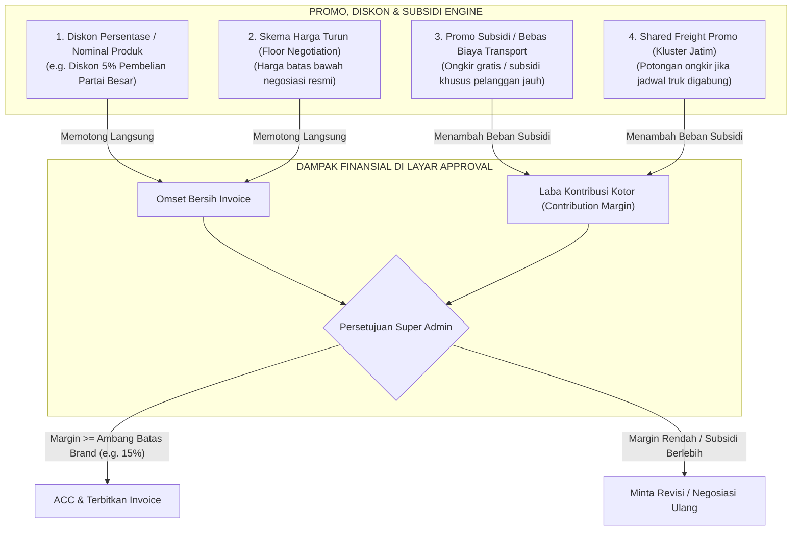

# SYSTEM BLUEPRINT (v2.1): OMNICAT ENTERPRISE DISTRIBUTION, CRM & FINANCIAL ENGINE
**Document Version:** `2.1.0-REVISED-AUDIT-ALIGNED`  
**Date:** November 2026  
**Status:** Approved for Implementation (Post-Audit Revision)  
**Database:** PostgreSQL 16 (Timezone: `Asia/Jakarta`)  
**Auditor Reference:** Menjawab seluruh temuan pada `Laporan Audit Rencana Aplikasi OmniCat.docx`  

---

## 1. Arsitektur Tingkat Tinggi & Prinsip Desain

Berdasarkan hasil audit tim, sistem dirancang dengan prinsip:
1. **Pemisahan Tiga Rilis Bertahap**: Rilis 1 (Inti Uang & Dokumen), Rilis 2 (Penjualan Lapangan & CRM), Rilis 3 (Optimasi & Ekosistem).
2. **Definisi Finansial yang Presisi**:
   - Membedakan dengan tegas antara **Biaya Transport yang Ditagihkan ke Pelanggan** (komponen invoice) dan **Biaya Riil Ekspedisi Truk Vendor**.
   - **Subsidi Ongkir Bersih** dihitung sebagai: $\text{Realisasi Biaya Ekspedisi} - \text{Biaya Transport yang Ditagihkan ke Pelanggan}$.
   - Menggunakan istilah baku **Laba Kontribusi Kotor (Contribution Margin)** dan bukan *Net Profit*, karena belum memperhitungkan overhead umum dan beban operasional tetap (SG&A).
3. **Pemisahan Data Finansial (HPP Isolation)**:
   - Data HPP/COGS dan Laba dipisahkan ke tabel khusus (`order_financials` & `product_cogs_history`) dengan hak akses database ketat agar tidak bocor ke peran Sales.
4. **Keamanan Dokumen Anti-Lompat**:
   - Menggunakan `INSERT ... ON CONFLICT (customer_id, brand_id) DO UPDATE` dengan row lock PostgreSQL.
   - Kolom `doc_number` di tabel `orders` bersifat *nullable* sampai pesanan resmi disetujui (Status `APPROVED`).
   - Penambahan status dokumen: `DRAFT`, `PENDING_APPROVAL`, `APPROVED`, `REVISION_REQUESTED`, `VOID`, `SUPERSEDED`, `SKIPPED_AUDIT`.

---

## 2. Arsitektur Modul Promo, Potongan Harga & Subsidi Ongkir

Sistem menyediakan engine terpadu untuk mengelola 4 jenis insentif penjualan:



### Aturan Bisnis Diskon & Subsidi:
1. **Promo Diskon Produk**:
   - Diskon hingga **$\le 3\%$** dapat diajukan langsung oleh Sales sebagai penawaran standar.
   - Diskon **$> 3\%$** atau harga khusus di bawah *Harga Turun* otomatis memicu status `REQUIRES_SPECIAL_APPROVAL`.
2. **Biaya Transport vs Subsidi Ongkir**:
   - **Biaya Transport Invoice (`transport_fee_billed`)**: Nilai yang ditagihkan kepada toko di PDF Invoice.
   - **Biaya Ekspedisi Truk Riil (`actual_freight_cost`)**: Tagihan dari vendor truk ekspedisi.
   - **Beban Subsidi Ongkir**:
     $$\text{Beban Subsidi Ditanggung Perusahaan} = \max(0, \text{actual\_freight\_cost} - \text{transport\_fee\_billed})$$
3. **Pajak (PPN)**:
   - Disediakan flag `is_tax_enabled` (default `FALSE` untuk entitas non-PKP). Jika diaktifkan, PPN (11% atau tarif berlaku) dihitung terpisah dari subtotal produk dan tidak mengurangi margin kotor.

---

## 3. Database Schema (PostgreSQL 16 DDL Lengkap & Terkoreksi)

```sql
-- ============================================================================
-- 0. EXTENSIONS & ENUMS
-- ============================================================================
CREATE EXTENSION IF NOT EXISTS "uuid-ossp";
CREATE EXTENSION IF NOT EXISTS "pgcrypto";

SET timezone = 'Asia/Jakarta';

CREATE TYPE user_role_enum AS ENUM ('SUPER_ADMIN', 'FINANCE', 'SALES', 'MANAGEMENT_VIEWER');
CREATE TYPE order_status_enum AS ENUM (
    'DRAFT', 
    'PENDING_APPROVAL', 
    'REVISION_REQUESTED',
    'APPROVED', 
    'VOID', 
    'SUPERSEDED',
    'SKIPPED_AUDIT',
    'SHIPPED', 
    'COMPLETED', 
    'CANCELLED'
);
CREATE TYPE payment_type_enum AS ENUM ('DP', 'PELUNASAN', 'FULL_PAYMENT');
CREATE TYPE payment_status_enum AS ENUM ('UNPAID', 'PARTIAL_DP', 'PAID_LUNAS');
CREATE TYPE churn_risk_enum AS ENUM ('LOW', 'MEDIUM', 'HIGH', 'CHURNED');
CREATE TYPE unit_type_enum AS ENUM ('LITER', 'KILOGRAM', 'SAK', 'PCS', 'TON');
CREATE TYPE promo_type_enum AS ENUM ('PERCENTAGE_DISCOUNT', 'FIXED_DISCOUNT', 'FREE_TRANSPORT', 'SUBSIDIZED_TRANSPORT', 'FREE_GOODS');

-- ============================================================================
-- 1. BRANDS & USER ACCESS CONTROL
-- ============================================================================
CREATE TABLE brands (
    id UUID PRIMARY KEY DEFAULT gen_random_uuid(),
    code VARCHAR(30) UNIQUE NOT NULL, -- 'BENTOCAT', 'ZEOLITE_MOJO'
    name VARCHAR(150) NOT NULL,
    legal_entity_name VARCHAR(200) NOT NULL,
    address TEXT NOT NULL,
    phone VARCHAR(50),
    email VARCHAR(100),
    website VARCHAR(150),
    invoice_doc_prefix VARCHAR(30) DEFAULT 'RO',
    min_contribution_margin_percent NUMERIC(5,2) DEFAULT 15.00, -- Ambang batas approval
    is_tax_enabled BOOLEAN DEFAULT FALSE,
    tax_rate_percent NUMERIC(5,2) DEFAULT 11.00,
    logo_url TEXT,
    is_active BOOLEAN DEFAULT TRUE,
    created_at TIMESTAMP WITH TIME ZONE DEFAULT CURRENT_TIMESTAMP,
    updated_at TIMESTAMP WITH TIME ZONE DEFAULT CURRENT_TIMESTAMP
);

CREATE TABLE brand_bank_accounts (
    id UUID PRIMARY KEY DEFAULT gen_random_uuid(),
    brand_id UUID NOT NULL REFERENCES brands(id) ON DELETE CASCADE,
    bank_name VARCHAR(50) NOT NULL, -- e.g. 'BCA'
    account_number VARCHAR(50) NOT NULL,
    account_holder_name VARCHAR(150) NOT NULL,
    is_primary BOOLEAN DEFAULT TRUE,
    created_at TIMESTAMP WITH TIME ZONE DEFAULT CURRENT_TIMESTAMP
);

CREATE TABLE users (
    id UUID PRIMARY KEY DEFAULT gen_random_uuid(),
    username VARCHAR(50) UNIQUE NOT NULL,
    full_name VARCHAR(150) NOT NULL,
    email VARCHAR(150) UNIQUE,
    phone_number VARCHAR(30),
    password_hash TEXT NOT NULL,
    role user_role_enum NOT NULL DEFAULT 'SALES',
    telegram_user_id BIGINT UNIQUE,
    telegram_chat_id BIGINT,
    is_active BOOLEAN DEFAULT TRUE,
    created_at TIMESTAMP WITH TIME ZONE DEFAULT CURRENT_TIMESTAMP,
    updated_at TIMESTAMP WITH TIME ZONE DEFAULT CURRENT_TIMESTAMP
);

-- Pengaman Isolasi Brand per Pengguna (Menjawab Temuan Audit 3.4)
CREATE TABLE user_brand_access (
    user_id UUID NOT NULL REFERENCES users(id) ON DELETE CASCADE,
    brand_id UUID NOT NULL REFERENCES brands(id) ON DELETE CASCADE,
    can_approve_orders BOOLEAN DEFAULT FALSE,
    PRIMARY KEY (user_id, brand_id)
);

-- ============================================================================
-- 2. REGIONS, CLUSTERS & CUSTOMERS
-- ============================================================================
CREATE TABLE clusters (
    id UUID PRIMARY KEY DEFAULT gen_random_uuid(),
    code VARCHAR(50) UNIQUE NOT NULL,
    name VARCHAR(100) NOT NULL,
    description TEXT
);

CREATE TABLE regions (
    id UUID PRIMARY KEY DEFAULT gen_random_uuid(),
    cluster_id UUID REFERENCES clusters(id) ON DELETE SET NULL,
    name VARCHAR(100) NOT NULL,
    province VARCHAR(100) NOT NULL,
    timezone VARCHAR(50) DEFAULT 'Asia/Jakarta', -- Mendukung Asia/Jayapura untuk Timika
    default_truck_capacity NUMERIC(12,2) DEFAULT 8000.0,
    default_truck_unit unit_type_enum DEFAULT 'LITER',
    standard_transport_subsidy NUMERIC(15,2) DEFAULT 850000.0,
    created_at TIMESTAMP WITH TIME ZONE DEFAULT CURRENT_TIMESTAMP
);

CREATE TABLE customers (
    id UUID PRIMARY KEY DEFAULT gen_random_uuid(),
    brand_id UUID NOT NULL REFERENCES brands(id) ON DELETE CASCADE,
    region_id UUID NOT NULL REFERENCES regions(id),
    name VARCHAR(200) NOT NULL,
    owner_doctor_name VARCHAR(150),
    phone VARCHAR(50),
    shipping_address TEXT NOT NULL,
    assigned_sales_id UUID REFERENCES users(id) ON DELETE SET NULL,
    credit_limit_amount NUMERIC(15,2) DEFAULT 0, -- Batas kredit toko
    
    -- Metrik Interval Berjalan
    avg_order_interval_days NUMERIC(6,2) DEFAULT 0,
    median_order_interval_days NUMERIC(6,2) DEFAULT 0, -- Tahan outlier
    avg_order_volume NUMERIC(12,2) DEFAULT 0,
    total_lifetime_orders INT DEFAULT 0,
    total_lifetime_revenue NUMERIC(18,2) DEFAULT 0,
    last_order_date DATE,
    predicted_next_order_date DATE,
    churn_risk churn_risk_enum DEFAULT 'LOW',
    
    created_at TIMESTAMP WITH TIME ZONE DEFAULT CURRENT_TIMESTAMP,
    updated_at TIMESTAMP WITH TIME ZONE DEFAULT CURRENT_TIMESTAMP,
    UNIQUE (brand_id, name) -- Mencegah toko ganda di brand yang sama
);

-- Sequence Counter Anti-Lompat per Toko
CREATE TABLE customer_doc_sequences (
    customer_id UUID NOT NULL REFERENCES customers(id) ON DELETE CASCADE,
    brand_id UUID NOT NULL REFERENCES brands(id) ON DELETE CASCADE,
    last_doc_number INT NOT NULL DEFAULT 0,
    updated_at TIMESTAMP WITH TIME ZONE DEFAULT CURRENT_TIMESTAMP,
    PRIMARY KEY (customer_id, brand_id)
);

-- ============================================================================
-- 3. PRODUCTS, HPP (COGS) HISTORY & PROMOS
-- ============================================================================
CREATE TABLE products (
    id UUID PRIMARY KEY DEFAULT gen_random_uuid(),
    brand_id UUID NOT NULL REFERENCES brands(id) ON DELETE CASCADE,
    sku_prefix VARCHAR(20) NOT NULL,
    name VARCHAR(150) NOT NULL,
    category VARCHAR(50) NOT NULL,
    base_unit unit_type_enum NOT NULL DEFAULT 'LITER', -- Mendukung LITER (BentoCat) & KG/TON (Zeolite)
    is_active BOOLEAN DEFAULT TRUE,
    created_at TIMESTAMP WITH TIME ZONE DEFAULT CURRENT_TIMESTAMP
);

CREATE TABLE product_variants (
    id UUID PRIMARY KEY DEFAULT gen_random_uuid(),
    product_id UUID NOT NULL REFERENCES products(id) ON DELETE CASCADE,
    sku VARCHAR(50) UNIQUE NOT NULL, -- 'BNT25', 'BNT10', 'BNT55'
    name VARCHAR(100) NOT NULL,
    packaging_unit VARCHAR(20) NOT NULL, -- 'sak', 'pcs'
    unit_multiplier NUMERIC(10,2) NOT NULL, -- 25.0 untuk 25L, 10.0 untuk 10L
    weight_kg NUMERIC(10,2),
    is_active BOOLEAN DEFAULT TRUE,
    created_at TIMESTAMP WITH TIME ZONE DEFAULT CURRENT_TIMESTAMP
);

-- Riwayat HPP Berlaku-Tanggal (Menjawab Temuan Audit 2.1 & 3.3)
CREATE TABLE product_cogs_history (
    id UUID PRIMARY KEY DEFAULT gen_random_uuid(),
    variant_id UUID NOT NULL REFERENCES product_variants(id) ON DELETE CASCADE,
    raw_material_cogs NUMERIC(15,2) NOT NULL,
    packaging_cogs NUMERIC(15,2) NOT NULL,
    labor_handling_cogs NUMERIC(15,2) NOT NULL DEFAULT 0,
    total_cogs_per_unit NUMERIC(15,2) GENERATED ALWAYS AS (
        raw_material_cogs + packaging_cogs + labor_handling_cogs
    ) STORED,
    effective_from DATE NOT NULL,
    effective_to DATE,
    created_by_user_id UUID REFERENCES users(id),
    created_at TIMESTAMP WITH TIME ZONE DEFAULT CURRENT_TIMESTAMP
);

-- Skema Harga Berlaku-Tanggal per Wilayah
CREATE TABLE price_tiers (
    id UUID PRIMARY KEY DEFAULT gen_random_uuid(),
    brand_id UUID NOT NULL REFERENCES brands(id) ON DELETE CASCADE,
    region_id UUID NOT NULL REFERENCES regions(id) ON DELETE CASCADE,
    variant_id UUID NOT NULL REFERENCES product_variants(id) ON DELETE CASCADE,
    price_lama NUMERIC(15,2) NOT NULL,
    price_baru NUMERIC(15,2) NOT NULL,
    price_turun NUMERIC(15,2) NOT NULL, -- Batas bawah negosiasi sales
    effective_from DATE NOT NULL,
    effective_to DATE,
    created_at TIMESTAMP WITH TIME ZONE DEFAULT CURRENT_TIMESTAMP,
    CONSTRAINT chk_price_order CHECK (price_turun <= price_baru)
);

-- Engine Promo & Potongan Harga
CREATE TABLE promotions (
    id UUID PRIMARY KEY DEFAULT gen_random_uuid(),
    brand_id UUID NOT NULL REFERENCES brands(id) ON DELETE CASCADE,
    code VARCHAR(50) UNIQUE NOT NULL, -- e.g. 'PROMO-MERDEKA-5', 'SUBSIDI-CILACAP-2026'
    name VARCHAR(150) NOT NULL,
    promo_type promo_type_enum NOT NULL,
    discount_percent NUMERIC(5,2) DEFAULT 0,
    discount_fixed_amount NUMERIC(15,2) DEFAULT 0,
    min_order_volume NUMERIC(12,2) DEFAULT 0, -- Syarat minimum volume (L/Kg)
    start_date DATE NOT NULL,
    end_date DATE NOT NULL,
    requires_admin_approval BOOLEAN DEFAULT FALSE,
    is_active BOOLEAN DEFAULT TRUE,
    created_at TIMESTAMP WITH TIME ZONE DEFAULT CURRENT_TIMESTAMP
);

-- ============================================================================
-- 4. ORDERS & FINANCIAL CLEARANCE
-- ============================================================================
CREATE TABLE orders (
    id UUID PRIMARY KEY DEFAULT gen_random_uuid(),
    brand_id UUID NOT NULL REFERENCES brands(id) ON DELETE RESTRICT,
    customer_id UUID NOT NULL REFERENCES customers(id) ON DELETE RESTRICT,
    created_by_sales_id UUID NOT NULL REFERENCES users(id),
    parent_order_id UUID REFERENCES orders(id), -- Melacak riwayat revisi
    
    -- Nomor Dokumen: Nullable saat draft/pending, dikunci saat disetujui (Temuan 3.1)
    doc_number INT,
    revision_number INT NOT NULL DEFAULT 0,
    order_date DATE NOT NULL,
    estimated_delivery_date DATE,
    actual_delivery_date DATE,
    status order_status_enum NOT NULL DEFAULT 'PENDING_APPROVAL',
    
    -- Agregat Volume
    total_order_volume NUMERIC(12,2) NOT NULL DEFAULT 0,
    
    -- Komponen Tagihan Penjualan (Billed to Customer)
    gross_product_subtotal NUMERIC(15,2) NOT NULL,
    promotion_id UUID REFERENCES promotions(id),
    discount_amount NUMERIC(15,2) DEFAULT 0,
    transport_fee_billed NUMERIC(15,2) DEFAULT 0, -- Biaya transport yang DITAGIHKAN ke toko
    unloading_fee_billed NUMERIC(15,2) DEFAULT 0, -- Biaya bongkar yang DITAGIHKAN ke toko
    tax_amount NUMERIC(15,2) DEFAULT 0,
    net_invoice_grand_total NUMERIC(15,2) NOT NULL,
    
    -- Approval Metadata
    approved_by_admin_id UUID REFERENCES users(id),
    approved_at TIMESTAMP WITH TIME ZONE,
    rejection_reason TEXT,
    notes TEXT,
    legacy_doc_ref VARCHAR(100), -- Referensi dokumen lama saat migrasi ETL
    
    created_at TIMESTAMP WITH TIME ZONE DEFAULT CURRENT_TIMESTAMP,
    updated_at TIMESTAMP WITH TIME ZONE DEFAULT CURRENT_TIMESTAMP,
    
    -- Constraint Unik Mutlak untuk Dokumen yang sudah Disetujui (Temuan 3.1)
    CONSTRAINT uq_customer_approved_doc UNIQUE (customer_id, brand_id, doc_number, revision_number)
);

CREATE INDEX idx_orders_status ON orders(status);
CREATE INDEX idx_orders_customer ON orders(customer_id);

CREATE TABLE order_items (
    id UUID PRIMARY KEY DEFAULT gen_random_uuid(),
    order_id UUID NOT NULL REFERENCES orders(id) ON DELETE CASCADE,
    variant_id UUID NOT NULL REFERENCES product_variants(id),
    quantity INT NOT NULL CHECK (quantity > 0),
    unit_price NUMERIC(15,2) NOT NULL, -- Snapshot harga jual
    cogs_per_unit NUMERIC(15,2) NOT NULL, -- Snapshot HPP saat order dibuat
    line_subtotal NUMERIC(15,2) NOT NULL,
    line_cogs_total NUMERIC(15,2) NOT NULL,
    line_contribution_margin NUMERIC(15,2) NOT NULL
);

-- TABEL FINANSIAL TERISOLASI (Tidak Boleh Diakses Role SALES - Temuan 3.4)
CREATE TABLE order_financials (
    order_id UUID PRIMARY KEY REFERENCES orders(id) ON DELETE CASCADE,
    total_cogs_amount NUMERIC(15,2) NOT NULL, -- Total HPP barang
    actual_freight_cost NUMERIC(15,2) NOT NULL DEFAULT 0, -- Realisasi tagihan truk vendor
    actual_unloading_cost NUMERIC(15,2) NOT NULL DEFAULT 0, -- Realisasi upah bongkar riil
    net_transport_subsidy_borne NUMERIC(15,2) NOT NULL, -- actual_freight - transport_fee_billed
    contribution_margin_amount NUMERIC(15,2) NOT NULL, -- net_invoice - cogs - actual_freight - actual_unloading
    contribution_margin_percent NUMERIC(5,2) NOT NULL,
    is_margin_healthy BOOLEAN NOT NULL DEFAULT TRUE
);

-- ============================================================================
-- 5. INVOICES, PAYMENTS & PIUTANG (AGING)
-- ============================================================================
CREATE TABLE invoices (
    id UUID PRIMARY KEY DEFAULT gen_random_uuid(),
    order_id UUID UNIQUE NOT NULL REFERENCES orders(id) ON DELETE RESTRICT,
    invoice_number VARCHAR(100) UNIQUE NOT NULL,
    issue_date DATE NOT NULL,
    due_date DATE NOT NULL,
    total_amount NUMERIC(15,2) NOT NULL,
    amount_paid NUMERIC(15,2) NOT NULL DEFAULT 0,
    -- Perbaikan Bug Generated Column (Temuan 3.2):
    remaining_balance NUMERIC(15,2) GENERATED ALWAYS AS (total_amount - amount_paid) STORED,
    payment_status payment_status_enum NOT NULL DEFAULT 'UNPAID',
    pdf_storage_path TEXT,
    created_at TIMESTAMP WITH TIME ZONE DEFAULT CURRENT_TIMESTAMP
);

CREATE TABLE payments (
    id UUID PRIMARY KEY DEFAULT gen_random_uuid(),
    invoice_id UUID NOT NULL REFERENCES invoices(id) ON DELETE CASCADE,
    payment_type payment_type_enum NOT NULL,
    amount NUMERIC(15,2) NOT NULL CHECK (amount > 0),
    payment_date DATE NOT NULL,
    payment_method VARCHAR(50) DEFAULT 'BCA Transfer',
    proof_image_url TEXT,
    verified_by_user_id UUID REFERENCES users(id),
    notes TEXT,
    created_at TIMESTAMP WITH TIME ZONE DEFAULT CURRENT_TIMESTAMP
);

-- ============================================================================
-- 6. AUDIT LOGGING (TAMPER-EVIDENT HASH CHAIN)
-- ============================================================================
CREATE TABLE audit_logs (
    id BIGSERIAL PRIMARY KEY,
    brand_id UUID REFERENCES brands(id) ON DELETE SET NULL,
    user_id UUID REFERENCES users(id),
    action VARCHAR(50) NOT NULL,
    entity_table VARCHAR(50) NOT NULL,
    entity_id UUID NOT NULL,
    old_values JSONB,
    new_values JSONB,
    ip_address VARCHAR(45),
    created_at TIMESTAMP WITH TIME ZONE DEFAULT CURRENT_TIMESTAMP,
    previous_record_hash TEXT, -- Rantai hash pengaman integritas audit
    record_hash TEXT NOT NULL
);

-- Revoke hak modifikasi audit log (Hanya bisa INSERT)
REVOKE UPDATE, DELETE ON audit_logs FROM PUBLIC;
```

---

## 4. Mekanisme Penomoran Atomic Anti-Lompat (Koreksi Temuan 3.1)

```sql
-- Fungsi Atomic untuk Mengunci Nomor Dokumen saat Order Disetujui (Approved)
CREATE OR REPLACE FUNCTION lock_and_assign_doc_number(
    p_order_id UUID,
    p_admin_id UUID
) RETURNS INT AS $$
DECLARE
    v_customer_id UUID;
    v_brand_id UUID;
    v_next_doc INT;
BEGIN
    -- 1. Ambil info order dan pastikan status masih PENDING_APPROVAL
    SELECT customer_id, brand_id INTO v_customer_id, v_brand_id
    FROM orders 
    WHERE id = p_order_id AND status = 'PENDING_APPROVAL';
    
    IF NOT FOUND THEN
        RAISE EXCEPTION 'Order tidak ditemukan atau status bukan PENDING_APPROVAL';
    END IF;

    -- 2. Upsert Sequence Counter dengan Row-Lock (Menjawab Temuan Audit Paragraf 61)
    INSERT INTO customer_doc_sequences (customer_id, brand_id, last_doc_number, updated_at)
    VALUES (v_customer_id, v_brand_id, 1, NOW())
    ON CONFLICT (customer_id, brand_id)
    DO UPDATE SET 
        last_doc_number = customer_doc_sequences.last_doc_number + 1,
        updated_at = NOW()
    RETURNING last_doc_number INTO v_next_doc;

    -- 3. Update Order menjadi APPROVED dan sematkan nomor dokumen
    UPDATE orders 
    SET 
        doc_number = v_next_doc,
        status = 'APPROVED',
        approved_by_admin_id = p_admin_id,
        approved_at = NOW(),
        updated_at = NOW()
    WHERE id = p_order_id;

    RETURN v_next_doc;
END;
$$ LANGUAGE plpgsql;
```
