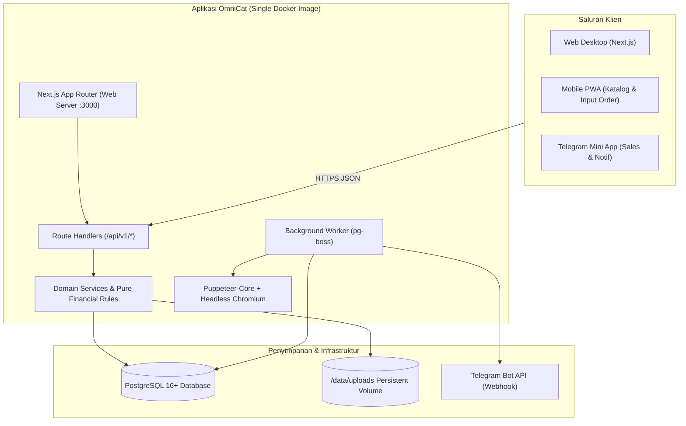
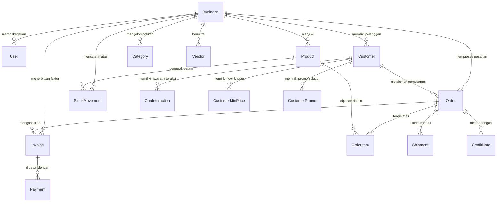
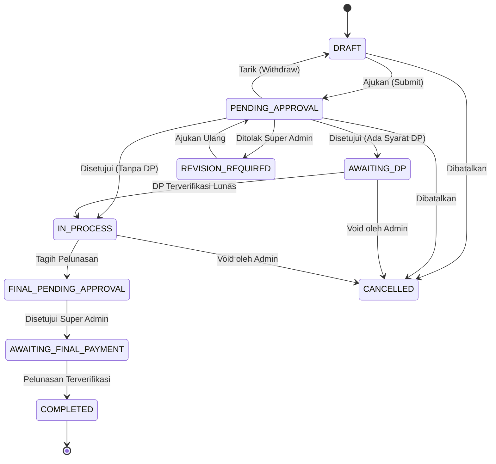

# Blueprint Sistem OmniCat: Order, CRM, dan Invoice Multi-Usaha

Dokumen hidup arsitektur, spesifikasi teknis, aturan bisnis, dan operasional sistem OmniCat. Diperbarui secara berkala pada setiap perubahan desain dan implementasi tugas.

---

## 1. Ringkasan sistem

OmniCat adalah platform manajemen order, CRM pelanggan, penerbitan invoice bertahap, dan pelacakan profitabilitas multi-usaha yang dirancang khusus untuk satu Super Admin (pemilik bisnis) dan puluhan staf Sales lapangan di berbagai unit bisnis/cabang. Sistem beroperasi dengan isolasi data tingkat usaha (multi-tenancy berbasis baris), aturan pembulatan keuangan integer-only (Rupiah utuh & basis points), pencegahan kebocoran data rahasia (HPP/margin) ke Sales, persetujuan ketat (approval workflow) atas invoice dan diskon di bawah harga minimal, serta dukungan akses multi-saluran melalui Web Desktop, Progressive Web App (PWA) di perangkat seluler, dan Telegram Mini App (TMA).

---

## 2. Versi stack

Tabel versi dependensi inti yang dikunci persis tanpa rentang versi (`^` atau `~`):

| Komponen        | Paket / Runtime   | Versi Terkunci | Keterangan                                             |
| --------------- | ----------------- | -------------- | ------------------------------------------------------ |
| Runtime         | Node.js           | `22.17.0`      | Node.js LTS aktif tercatat di `.nvmrc` dan `engines`   |
| Package Manager | pnpm              | `12.18.0`      | Manajemen dependensi ketat dan deterministik           |
| Web Framework   | Next.js           | `15.3.9`       | App Router, standalone Docker build                    |
| Bahasa          | TypeScript        | `5.7.3`        | `strict: true`, no `any`, no unhandled errors          |
| Library UI      | React & React DOM | `19.0.0`       | Server & Client Components                             |
| Validasi Skema  | Zod               | `3.24.2`       | Validasi input Route Handler dengan `.strict()`        |
| Database & ORM  | PostgreSQL        | `16+`          | Database relasional multi-tenant                       |
| ORM Client      | Prisma            | `7.10.1`       | Skema relasional, raw query ber-tag, extension isolasi |
| Pengujian Unit  | Vitest            | `3.0.5`        | Unit testing cepat untuk rumus domain dan logika murni |
| Pengujian E2E   | Playwright        | `1.50.1`       | Pengujian skenario lintas antarmuka dan role           |
| Password Hash   | argon2            | `0.45.2`       | Hashing password argon2id dengan parameter OWASP       |
| Styling CSS     | Tailwind CSS      | `3.4.17`       | Framework utilitas CSS mobile-first responsif          |
| UI Icons        | Lucide React      | `0.475.0`      | Ikonografi antarmuka terpadu                           |
| Olah Gambar     | sharp             | `0.35.5`       | Pemrosesan citra, strip EXIF, convert WebP, anti-traversal |
| TS Runner       | tsx               | `4.23.15`      | Eksekutor TypeScript cepat untuk seed dan skrip        |
| Linter          | ESLint            | `9.20.1`       | Analisis statis kode                                   |
| Pemformat Kode  | Prettier          | `3.5.1`        | Standar konsistensi format kode                        |

---

## 3. Model data

Model data PostgreSQL dikelola melalui Prisma ORM dengan isolasi ketat `businessId` di setiap entitas usaha dan audit log berbasis append-only trigger.

Daftar tabel inti:

1. `Business`: Profil unit bisnis (kode unik, tema invoice, NPWP, toggle PPN, toggle stok minus, toggle DP wajib).
2. `User`: Akun pengguna (Super Admin dan Sales), tautan Telegram, last login.
3. `Session`: Sesi login pengguna (token hash, expiry, IP, user-agent).
4. `Customer`: Data pelanggan per usaha dengan kode unik (contoh: TEROBOS).
5. `Product`: Master produk, HPP rahasia (`costPrice`), harga dasar (`basePrice`), harga minimal (`minPrice`).
6. `Order` & `OrderItem`: Dokumen pesanan dan rincian baris barang dengan snapshot harga.
7. `Invoice`: Tagihan bertahap (`DP` dan `FINAL`/Pelunasan).
8. `Payment`: Transaksi pembayaran dan bukti bayar.
9. `Shipment`: Surat jalan pengiriman fisik barang.
10. `CreditNote`: Retur barang dan koreksi tagihan.
11. `StockMovement`: Buku besar pergerakan stok barang.
12. `AuditLog`: Log mutasi append-only yang tidak dapat diubah.

---

## 4. Matriks hak akses

| Kemampuan / Fitur                                      | Super Admin                        | Sales                                             |
| ------------------------------------------------------ | ---------------------------------- | ------------------------------------------------- |
| Login, logout, ganti password sendiri                  | Ya                                 | Ya                                                |
| Kelola profil usaha, logo, rekening bank, tema invoice | Ya                                 | Tidak                                             |
| Kelola akun Sales, target, dan skema komisi            | Ya                                 | Tidak                                             |
| Kelola vendor (pemasok & ekspedisi)                    | Ya                                 | Tidak                                             |
| Lihat produk                                           | Semua, lengkap dengan HPP & margin | Produk aktif, tanpa HPP, ada harga minimal & stok |
| Ubah harga master produk & riwayat HPP                 | Ya                                 | Tidak                                             |
| Ajukan order baru                                      | Ya                                 | Ya (hanya untuk customernya sendiri)              |
| Ajukan harga di bawah minimal                          | -                                  | Ya (wajib sertakan alasan pengajuan)              |
| Setujui / tolak invoice (Approval)                     | Ya                                 | Tidak                                             |
| Setujui override harga di bawah minimal                | Ya                                 | Tidak                                             |
| Input & verifikasi pembayaran                          | Ya                                 | Ya (hanya input), Verifikasi hanya Super Admin    |
| Cetak Invoice PDF                                      | Ya                                 | Ya (hanya jika status APPROVED)                   |
| Cetak Surat Jalan                                      | Ya                                 | Ya (jika order sudah disetujui)                   |
| Lihat laporan profitabilitas & margin                  | Ya                                 | Tidak (Dilarang keras / bocor)                    |
| Lihat nilai komisi                                     | Ya                                 | Tidak                                             |

---

## 5. Aturan bisnis

1. **Uang & Angka**: Semua nominal uang disimpan dalam bilangan bulat Rupiah (`BigInt`/`number`). Persen disimpan dalam basis points ($1\% = 100$ bps). Perhitungan murni di `src/lib/domain/`.
2. **Floor Pricing**: Harga jual minimal customer dihitung dari $\max(\text{product.minPrice}, \text{customer.floorPrice})$. Bila sales mengajukan di bawah floor, order berstatus `PENDING_APPROVAL` dengan flag `underMinPrice=true`.
3. **Pembagian Invoice Bertahap**:
   - Invoice DP dihitung: $\text{round}(\text{orderTotal} \times \text{dpBps} / 10000)$.
   - Invoice Pelunasan (FINAL): $\text{orderTotal} - \text{dpPaid} - \text{creditApplied}$.
4. **Pencegahan Celah**:
   - Order yang sudah disetujui tidak dapat disunting kembali (wajib alur VOID atau Revisi).
   - Penomoran dokumen sequential per customer tanpa lompatan: `KODE/INV/DD/MM/YYYY/NNNN-[DP|LNS]`.
   - Stok dipotong saat pengiriman (atau di-reserve saat order disetujui, sesuai setting usaha).

---

## 6. Alur status

### Alur Dokumen Pesanan (Order)

---

## 7. Daftar endpoint

Semua endpoint bisnis berada di `/api/v1/*` dan mewajibkan otorisasi via `requireContext()`:

| Metode     | Endpoint Path                  | Hak Akses          | Deskripsi                                     |
| ---------- | ------------------------------ | ------------------ | --------------------------------------------- |
| `GET`      | `/api/health`                  | Publik             | Healthcheck database dan versi aplikasi       |
| `POST`     | `/api/v1/auth/login`           | Publik             | Otentikasi username/password, terbitkan sesi  |
| `POST`     | `/api/v1/auth/logout`          | Authenticated      | Revokasi sesi pengguna                        |
| `GET`      | `/api/v1/auth/me`              | Authenticated      | Profil user dan usaha aktif                   |
| `POST`     | `/api/v1/auth/change-password` | Authenticated      | Ganti password & revokasi sesi lain           |
| `POST`     | `/api/v1/session/business`     | Super Admin        | Memilih / mengganti unit usaha aktif di sesi  |
| `GET`      | `/api/v1/business`             | Authenticated      | Ringkasan info usaha aktif (kode, nama, logo) |
| `GET/POST` | `/api/v1/businesses`           | Super Admin        | CRUD data unit usaha                          |
| `GET/PATCH/DELETE` | `/api/v1/businesses/:id`   | Super Admin        | Detail, pengaturan usaha, dan soft delete     |
| `GET/POST` | `/api/v1/businesses/:id/bank-accounts` | Super Admin    | CRUD rekening bank unit usaha                 |
| `GET/PATCH/DELETE` | `/api/v1/bank-accounts/:id` | Super Admin       | Detail, set default, dan soft delete rekening |
| `POST`     | `/api/v1/businesses/:id/logo`  | Super Admin        | Unggah logo usaha (multipart/form-data)       |
| `GET`      | `/api/v1/files/:businessId/:kind/:filename` | Authenticated | Penyajian berkas aman & terisolasi       |
| `GET/POST` | `/api/v1/users`                | Super Admin        | CRUD akun staf sales                          |
| `GET/PATCH/DELETE` | `/api/v1/users/:id`        | Super Admin        | Detail, ubah data, soft delete user           |
| `POST`     | `/api/v1/users/:id/reset-password` | Super Admin    | Reset password & cabut seluruh sesi aktif     |
| `POST`     | `/api/v1/users/:id/deactivate` | Super Admin        | Nonaktifkan user & cabut seluruh sesi aktif   |
| `POST`     | `/api/v1/users/:id/activate`   | Super Admin        | Aktifkan kembali user                         |
| `POST`     | `/api/v1/auth/telegram/link-code` | Authenticated   | Buat kode tautan bot Telegram 8 karakter      |
| `DELETE`   | `/api/v1/auth/telegram`        | Authenticated      | Putuskan tautan bot Telegram                  |
| `GET/POST` | `/api/v1/categories`           | Super Admin, Sales | Master kategori produk (unik per usaha)       |
| `GET/PATCH/DELETE` | `/api/v1/categories/:id` | Super Admin, Sales | Detail (Sales), ubah/hapus (Super Admin)      |
| `GET/POST` | `/api/v1/products`             | Super Admin, Sales | Master produk (DTO disaring per role)         |
| `GET/PATCH/DELETE` | `/api/v1/products/:id` | Super Admin, Sales | Detail (Sales), rev/priceReason/soft delete   |
| `POST`     | `/api/v1/products/:id/images`  | Super Admin        | Unggah foto produk (maksimal 8, WebP 1600px)  |
| `PATCH/DELETE` | `/api/v1/products/:id/images/:imageId` | Super Admin | Atur foto utama/urutan, hapus foto         |
| `GET`      | `/api/v1/products/:id/price-history` | Super Admin  | Riwayat perubahan harga produk                |
| `GET/POST` | `/api/v1/vendors`              | Super Admin        | Master vendor & ekspedisi (SUPPLIER/TRANSPORT) |
| `GET/PATCH/DELETE` | `/api/v1/vendors/:id`  | Super Admin        | Detail, perbarui, soft delete vendor           |
| `GET`      | `/api/v1/updates`              | Super Admin, Sales | Daftar catatan rilis (SA draft & terbit, Sales terbit saja) |
| `GET`      | `/api/v1/updates/unread-count` | Super Admin, Sales | Hitungan rilis baru yang belum dilihat pengguna |
| `POST`     | `/api/v1/updates/mark-seen`    | Super Admin, Sales | Menandai rilis sudah dilihat pengguna           |
| `POST`     | `/api/v1/updates`              | Super Admin        | Buat catatan rilis baru (draft/langsung terbit)|
| `GET`      | `/api/v1/updates/:id`          | Super Admin, Sales | Detail catatan rilis (Sales 404 jika draf)     |
| `PATCH/DELETE` | `/api/v1/updates/:id`      | Super Admin        | Perbarui atau hapus catatan rilis               |
| `POST`     | `/api/v1/updates/:id/publish`  | Super Admin        | Terbitkan draf rilis (+ opsi broadcast)        |
| `GET/POST` | `/api/v1/customers`            | Super Admin, Sales | Data pelanggan & CRM                          |
| `POST`     | `/api/v1/orders/preview`       | Super Admin, Sales | Pratinjau hitungan total & floor              |
| `GET/POST` | `/api/v1/orders`               | Super Admin, Sales | Pencatatan & daftar order                     |
| `POST`     | `/api/v1/orders/:id/submit`    | Sales              | Mengajukan order ke Super Admin               |
| `POST`     | `/api/v1/invoices/:id/approve` | Super Admin        | Persetujuan invoice                           |
| `POST`     | `/api/v1/payments`             | Super Admin, Sales | Pencatatan pembayaran & bukti transfer        |
| `POST`     | `/api/v1/payments/:id/verify`  | Super Admin        | Verifikasi dana masuk                         |
| `GET`      | `/api/v1/invoices/:id/pdf`     | Authenticated      | Unduh berkas PDF invoice resmi                |

### Antarmuka Pengguna (UI Routes)

| Path                   | Hak Akses          | Deskripsi                                                        |
| ---------------------- | ------------------ | ---------------------------------------------------------------- |
| `/login`               | Publik             | Halaman login dengan rate-limiting & proteksi timing attack      |
| `/dashboard`           | Super Admin, Sales | Ringkasan navigasi cepat & kartu usaha aktif                     |
| `/profile`             | Super Admin, Sales | Pengaturan profil, ganti password, & integrasi bot Telegram      |
| `/settings/business`   | Super Admin        | Legalitas usaha, rekening bank, toggle operasional, tema invoice |
| `/settings/users`      | Super Admin        | Manajemen pengguna staf sales, reset password, skema komisi      |
| `/products`            | Super Admin, Sales | Katalog produk (kolom HPP/margin khusus SA; kartu mobile 360 px) |
| `/products/:id/prices` | Super Admin        | Kronologi riwayat perubahan harga produk & alasan bisnis         |
| `/vendors`             | Super Admin        | Manajemen vendor & rekanan logistik (kartu mobile 360 px)        |
| `/updates`             | Super Admin, Sales | Catatan pembaruan sistem dengan render markdown aman anti-XSS    |

---

## 8. Integrasi

1. **Telegram Bot**:
   - Menghubungkan akun menggunakan kode tautan sekali pakai (`/start <token>`).
   - Notifikasi persetujuan instan ke Super Admin dengan tombol _Setujui_, _Tolak_, atau tautan detail.
   - Pintu masuk Telegram Mini App (TMA) dengan validasi aman HMAC-SHA256 atas `initData`.
2. **Job Terjadwal (`pg-boss`)**:
   - `reminder-check`: Evaluasi repeat order pelanggan berdasarkan siklus interval pembelian.
   - `aging-ar-summary`: Rekapitulasi umur piutang jatuh tempo.
   - `telegram-retry`: Pengiriman ulang pesan notifikasi yang tertunda akibat rate-limit.

---

## 9. Operasional

1. **Deploy Coolify**:
   - Single Docker Image, multi-stage build.
   - Dua instance service: `web` (port 3000) dan `worker` (proses background).
   - Eksekusi migrasi hanya pada tahap pre-deploy service `web`: `pnpm prisma migrate deploy`.
2. **Backup & Restore**:
   - Jadwal snapshot database harian otomatis pada PostgreSQL.
   - Volume `/data/uploads` dicadangkan bersama snapshot harian.
3. **Pengujian Rutin**:
   - `pnpm lint`: Memastikan kebersihan sintaks dan aturan typescript.
   - `pnpm typecheck`: Memastikan kesesuaian tipe data dan integritas tanpa `@ts-ignore`.
   - `pnpm test`: Menjalankan suite Vitest pada unit rumus dan integrasi.

---

## 10. Keputusan teknis (ADR)

1. [ADR 0001: Representasi Uang dan Persentase](file:///D:/Data%20BentoCat/docs/adr/0001-uang-bigint.md) - Penggunaan BigInt Rupiah utuh & basis points (bps).
2. [ADR 0002: Pemilihan Teknologi Stack](file:///D:/Data%20BentoCat/docs/adr/0002-stack.md) - Next.js App Router, Prisma, Vitest, pg-boss, puppeteer-core.
3. [ADR 0003: Konfigurasi Datasource Prisma 7 dan Driver Adapter PostgreSQL](file:///D:/Data%20BentoCat/docs/adr/0003-prisma-7-config.md) - Penyesuaian konfigurasi prisma.config.ts, @prisma/adapter-pg, dan pglite.

---

## 11. Roadmap

| Fase       | Target Rilis | Deskripsi                                                               | Status              |
| ---------- | ------------ | ----------------------------------------------------------------------- | ------------------- |
| **Fase 0** | `v0.1.0`     | Fondasi proyek, env, skema Prisma, rumus domain, infra tes              | **SELESAI** |
| **Fase 1** | `v0.2.0`     | Login, manajemen usaha, akun sales, master produk & vendor, pembaruan   | **SELESAI** |
| **Fase 2** | `v0.3.0`     | Customer CRM, order draft, floor pricing, manajemen stok                | Belum dimulai       |
| **Fase 3** | `v0.4.0`     | Persetujuan invoice, verifikasi pembayaran, mesin cetak PDF, void/retur | Belum dimulai       |
| **Fase 4** | `v0.5.0`     | Bot Telegram, Mini App, pengingat repeat order, katalog PWA             | Belum dimulai       |
| **Fase 5** | `v1.0.0`     | Dashboard profit, evaluasi sales, pengerasan keamanan, Go-Live          | Belum dimulai       |

---

## 12. Masalah terbuka

Pelacakan masalah terbuka dan pertanyaan yang membutuhkan klarifikasi pemilik bisnis didokumentasikan pada:
[docs/OPEN_QUESTIONS.md](file:///D:/Data%20BentoCat/docs/OPEN_QUESTIONS.md)
