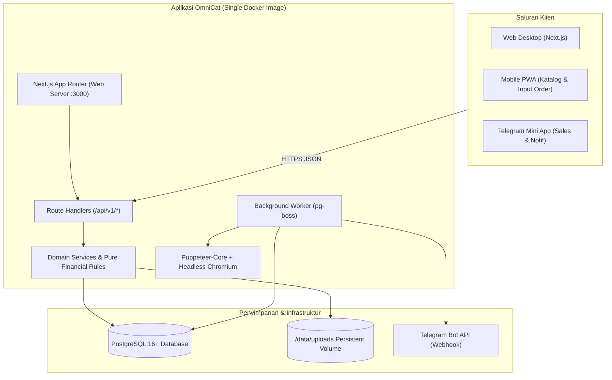
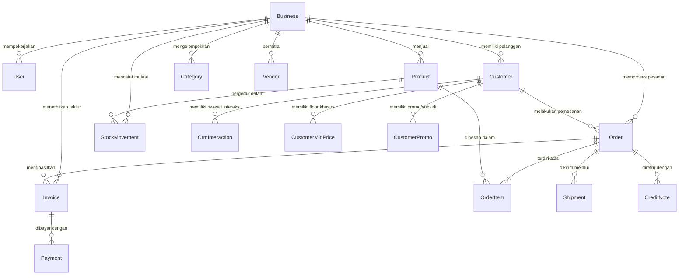
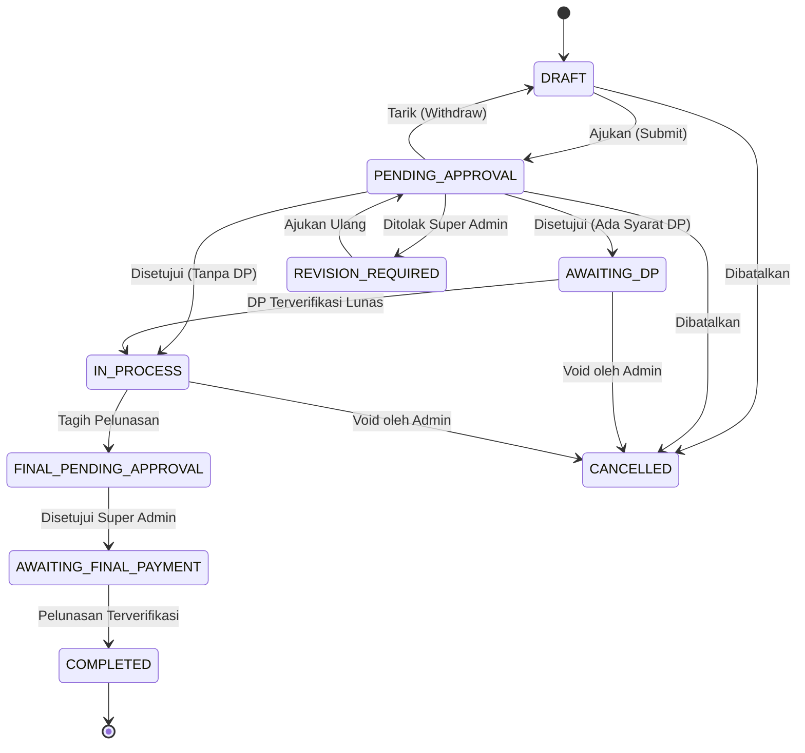

# Blueprint Sistem OmniCat: Order, CRM, dan Invoice Multi-Usaha

Dokumen hidup arsitektur, spesifikasi teknis, aturan bisnis, dan operasional sistem OmniCat. Diperbarui secara berkala pada setiap perubahan desain dan implementasi tugas.

---

## 1. Ringkasan sistem

OmniCat adalah platform manajemen order, CRM pelanggan, penerbitan invoice bertahap, dan pelacakan profitabilitas multi-usaha yang dirancang khusus untuk satu Super Admin (pemilik bisnis) dan puluhan staf Sales lapangan di berbagai unit bisnis/cabang. Sistem beroperasi dengan isolasi data tingkat usaha (multi-tenancy berbasis baris), aturan pembulatan keuangan integer-only (Rupiah utuh & basis points), pencegahan kebocoran data rahasia (HPP/margin) ke Sales, persetujuan ketat (approval workflow) atas invoice dan diskon di bawah harga minimal, serta dukungan akses multi-saluran melalui Web Desktop, Progressive Web App (PWA) di perangkat seluler, dan Telegram Mini App (TMA).

---

## 2. Versi stack

Tabel versi dependensi inti yang dikunci persis tanpa rentang versi (`^` atau `~`):

| Komponen        | Paket / Runtime   | Versi Terkunci | Keterangan                                             |
| --------------- | ----------------- | -------------- | ------------------------------------------------------ |
| Runtime         | Node.js           | `22.17.0`      | Node.js LTS aktif tercatat di `.nvmrc` dan `engines`   |
| Package Manager | pnpm              | `12.18.0`      | Manajemen dependensi ketat dan deterministik           |
| Web Framework   | Next.js           | `15.3.9`       | App Router, standalone Docker build                    |
| Bahasa          | TypeScript        | `5.7.3`        | `strict: true`, no `any`, no unhandled errors          |
| Library UI      | React & React DOM | `19.0.0`       | Server & Client Components                             |
| Validasi Skema  | Zod               | `3.24.2`       | Validasi input Route Handler dengan `.strict()`        |
| Database & ORM  | PostgreSQL        | `16+`          | Database relasional multi-tenant                       |
| ORM Client      | Prisma            | `7.10.1`       | Skema relasional, raw query ber-tag, extension isolasi |
| Pengujian Unit  | Vitest            | `3.0.5`        | Unit testing cepat untuk rumus domain dan logika murni |
| Pengujian E2E   | Playwright        | `1.50.1`       | Pengujian skenario lintas antarmuka dan role           |
| Password Hash   | argon2            | `0.45.2`       | Hashing password argon2id dengan parameter OWASP       |
| Styling CSS     | Tailwind CSS      | `3.4.17`       | Framework utilitas CSS mobile-first responsif          |
| UI Icons        | Lucide React      | `0.475.0`      | Ikonografi antarmuka terpadu                           |
| Olah Gambar     | sharp             | `0.35.5`       | Pemrosesan citra, strip EXIF, convert WebP, anti-traversal |
| TS Runner       | tsx               | `4.23.15`      | Eksekutor TypeScript cepat untuk seed dan skrip        |
| Linter          | ESLint            | `9.20.1`       | Analisis statis kode                                   |
| Pemformat Kode  | Prettier          | `3.5.1`        | Standar konsistensi format kode                        |

---

## 3. Model data

Model data PostgreSQL dikelola melalui Prisma ORM dengan isolasi ketat `businessId` di setiap entitas usaha dan audit log berbasis append-only trigger.

Daftar tabel inti:

1. `Business`: Profil unit bisnis (kode unik, tema invoice, NPWP, toggle PPN, toggle stok minus, toggle DP wajib).
2. `User`: Akun pengguna (Super Admin dan Sales), tautan Telegram, last login.
3. `Session`: Sesi login pengguna (token hash, expiry, IP, user-agent).
4. `Customer`: Data pelanggan per usaha dengan kode unik (contoh: TEROBOS).
5. `Product`: Master produk, HPP rahasia (`costPrice`), harga dasar (`basePrice`), harga minimal (`minPrice`).
6. `Order` & `OrderItem`: Dokumen pesanan dan rincian baris barang dengan snapshot harga.
7. `Invoice`: Tagihan bertahap (`DP` dan `FINAL`/Pelunasan).
8. `Payment`: Transaksi pembayaran dan bukti bayar.
9. `Shipment`: Surat jalan pengiriman fisik barang.
10. `CreditNote`: Retur barang dan koreksi tagihan.
11. `StockMovement`: Buku besar pergerakan stok barang.
12. `AuditLog`: Log mutasi append-only yang tidak dapat diubah.

---

## 4. Matriks hak akses

| Kemampuan / Fitur                                      | Super Admin                        | Sales                                             |
| ------------------------------------------------------ | ---------------------------------- | ------------------------------------------------- |
| Login, logout, ganti password sendiri                  | Ya                                 | Ya                                                |
| Kelola profil usaha, logo, rekening bank, tema invoice | Ya                                 | Tidak                                             |
| Kelola akun Sales, target, dan skema komisi            | Ya                                 | Tidak                                             |
| Kelola vendor (pemasok & ekspedisi)                    | Ya                                 | Tidak                                             |
| Lihat produk                                           | Semua, lengkap dengan HPP & margin | Produk aktif, tanpa HPP, ada harga minimal & stok |
| Ubah harga master produk & riwayat HPP                 | Ya                                 | Tidak                                             |
| Ajukan order baru                                      | Ya                                 | Ya (hanya untuk customernya sendiri)              |
| Ajukan harga di bawah minimal                          | -                                  | Ya (wajib sertakan alasan pengajuan)              |
| Setujui / tolak invoice (Approval)                     | Ya                                 | Tidak                                             |
| Setujui override harga di bawah minimal                | Ya                                 | Tidak                                             |
| Input & verifikasi pembayaran                          | Ya                                 | Ya (hanya input), Verifikasi hanya Super Admin    |
| Cetak Invoice PDF                                      | Ya                                 | Ya (hanya jika status APPROVED)                   |
| Cetak Surat Jalan                                      | Ya                                 | Ya (jika order sudah disetujui)                   |
| Lihat laporan profitabilitas & margin                  | Ya                                 | Tidak (Dilarang keras / bocor)                    |
| Lihat nilai komisi                                     | Ya                                 | Tidak                                             |

---

## 5. Aturan bisnis

1. **Uang & Angka**: Semua nominal uang disimpan dalam bilangan bulat Rupiah (`BigInt`/`number`). Persen disimpan dalam basis points ($1\% = 100$ bps). Perhitungan murni di `src/lib/domain/`.
2. **Floor Pricing**: Harga jual minimal customer dihitung dari $\max(\text{product.minPrice}, \text{customer.floorPrice})$. Bila sales mengajukan di bawah floor, order berstatus `PENDING_APPROVAL` dengan flag `underMinPrice=true`.
3. **Pembagian Invoice Bertahap**:
   - Invoice DP dihitung: $\text{round}(\text{orderTotal} \times \text{dpBps} / 10000)$.
   - Invoice Pelunasan (FINAL): $\text{orderTotal} - \text{dpPaid} - \text{creditApplied}$.
4. **Pencegahan Celah**:
   - Order yang sudah disetujui tidak dapat disunting kembali (wajib alur VOID atau Revisi).
   - Penomoran dokumen sequential per customer tanpa lompatan: `KODE/INV/DD/MM/YYYY/NNNN-[DP|LNS]`.
   - Stok dipotong saat pengiriman (atau di-reserve saat order disetujui, sesuai setting usaha).
5. **Otomatisasi CRM & Isolasi Tugas Follow-up (T2.2)**:
   - Pencatatan interaksi CRM (`POST /customers/:id/interactions`) dengan kolom tanggal follow-up (`nextFollowUpAt`) secara atomik dalam database transaction langsung menerbitkan entri tugas baru di tabel `CrmTask` untuk sales penanggung jawab.
   - Staf sales hanya mengelola tugas dan linimasa pelanggannya sendiri (`assignedToId = ctx.user.id`). Upaya membuka atau memodifikasi data milik sales lain selalu menghasilkan 404 `NOT_FOUND` guna mencegah penerobosan informasi pelanggan.
6. **Penomoran Dokumen Atomik & Isolasi Counter (T2.4 & Seksi 7.8)**:
   - Format penomoran dokumen resmi: `KODE/JENIS/DD/MM/YYYY/NNNN` berbasis tanggal lokal WIB (`Asia/Jakarta`).
   - Nomor order (`Order.orderNo`) dialokasikan saat invoice pertama disetujui (bukan saat draft). Urutan nomor berjalan per customer dan tidak pernah direset (`DocumentCounter` scope `ORDER_SEQ`).
   - Nomor invoice: `orderNo-DP` untuk uang muka dan `orderNo-LNS` untuk pelunasan, dengan akhiran versi revisi `-R1`, `-R2` bila versi > 1.
   - Surat jalan menggunakan jenis `SJ` dengan urutan order yang sama; Credit Note menggunakan jenis `CN` (`CREDIT_NOTE_SEQ`); PO vendor menggunakan jenis `PO` (`PO_SEQ`).
   - Alokasi dieksekusi melalui PostgreSQL UPSERT atomik (`nextSeq`) di dalam transaksi database yang sama dengan persetujuan dokumen. Transaksi yang rollback tidak menghanguskan nomor urut dan mencegah race condition pada alokasi serentak.

---

## 6. Alur status

### Alur Dokumen Pesanan (Order)

---

## 7. Daftar endpoint

Semua endpoint bisnis berada di `/api/v1/*` dan mewajibkan otorisasi via `requireContext()`:

| Metode     | Endpoint Path                  | Hak Akses          | Deskripsi                                     |
| ---------- | ------------------------------ | ------------------ | --------------------------------------------- |
| `GET`      | `/api/health`                  | Publik             | Healthcheck database dan versi aplikasi       |
| `POST`     | `/api/v1/auth/login`           | Publik             | Otentikasi username/password, terbitkan sesi  |
| `POST`     | `/api/v1/auth/logout`          | Authenticated      | Revokasi sesi pengguna                        |
| `GET`      | `/api/v1/auth/me`              | Authenticated      | Profil user dan usaha aktif                   |
| `POST`     | `/api/v1/auth/change-password` | Authenticated      | Ganti password & revokasi sesi lain           |
| `POST`     | `/api/v1/session/business`     | Super Admin        | Memilih / mengganti unit usaha aktif di sesi  |
| `GET`      | `/api/v1/business`             | Authenticated      | Ringkasan info usaha aktif (kode, nama, logo) |
| `GET/POST` | `/api/v1/businesses`           | Super Admin        | CRUD data unit usaha                          |
| `GET/PATCH/DELETE` | `/api/v1/businesses/:id`   | Super Admin        | Detail, pengaturan usaha, dan soft delete     |
| `GET/POST` | `/api/v1/businesses/:id/bank-accounts` | Super Admin    | CRUD rekening bank unit usaha                 |
| `GET/PATCH/DELETE` | `/api/v1/bank-accounts/:id` | Super Admin       | Detail, set default, dan soft delete rekening |
| `POST`     | `/api/v1/businesses/:id/logo`  | Super Admin        | Unggah logo usaha (multipart/form-data)       |
| `GET`      | `/api/v1/files/:businessId/:kind/:filename` | Authenticated | Penyajian berkas aman & terisolasi       |
| `GET/POST` | `/api/v1/users`                | Super Admin        | CRUD akun staf sales                          |
| `GET/PATCH/DELETE` | `/api/v1/users/:id`        | Super Admin        | Detail, ubah data, soft delete user           |
| `POST`     | `/api/v1/users/:id/reset-password` | Super Admin    | Reset password & cabut seluruh sesi aktif     |
| `POST`     | `/api/v1/users/:id/deactivate` | Super Admin        | Nonaktifkan user & cabut seluruh sesi aktif   |
| `POST`     | `/api/v1/users/:id/activate`   | Super Admin        | Aktifkan kembali user                         |
| `POST`     | `/api/v1/auth/telegram/link-code` | Authenticated   | Buat kode tautan bot Telegram 8 karakter      |
| `DELETE`   | `/api/v1/auth/telegram`        | Authenticated      | Putuskan tautan bot Telegram                  |
| `GET/POST` | `/api/v1/categories`           | Super Admin, Sales | Master kategori produk (unik per usaha)       |
| `GET/PATCH/DELETE` | `/api/v1/categories/:id` | Super Admin, Sales | Detail (Sales), ubah/hapus (Super Admin)      |
| `GET/POST` | `/api/v1/products`             | Super Admin, Sales | Master produk (DTO disaring per role)         |
| `GET/PATCH/DELETE` | `/api/v1/products/:id` | Super Admin, Sales | Detail (Sales), rev/priceReason/soft delete   |
| `POST`     | `/api/v1/products/:id/images`  | Super Admin        | Unggah foto produk (maksimal 8, WebP 1600px)  |
| `PATCH/DELETE` | `/api/v1/products/:id/images/:imageId` | Super Admin | Atur foto utama/urutan, hapus foto         |
| `GET`      | `/api/v1/products/:id/price-history` | Super Admin  | Riwayat perubahan harga produk                |
| `GET/POST` | `/api/v1/vendors`              | Super Admin        | Master vendor & ekspedisi (SUPPLIER/TRANSPORT) |
| `GET/PATCH/DELETE` | `/api/v1/vendors/:id`  | Super Admin        | Detail, perbarui, soft delete vendor           |
| `GET`      | `/api/v1/updates`              | Super Admin, Sales | Daftar catatan rilis (SA draft & terbit, Sales terbit saja) |
| `GET`      | `/api/v1/updates/unread-count` | Super Admin, Sales | Hitungan rilis baru yang belum dilihat pengguna |
| `POST`     | `/api/v1/updates/mark-seen`    | Super Admin, Sales | Menandai rilis sudah dilihat pengguna           |
| `POST`     | `/api/v1/updates`              | Super Admin        | Buat catatan rilis baru (draft/langsung terbit)|
| `GET`      | `/api/v1/updates/:id`          | Super Admin, Sales | Detail catatan rilis (Sales 404 jika draf)     |
| `PATCH/DELETE` | `/api/v1/updates/:id`      | Super Admin        | Perbarui atau hapus catatan rilis               |
| `POST`     | `/api/v1/updates/:id/publish`  | Super Admin        | Terbitkan draf rilis (+ opsi broadcast)        |
| `GET/POST` | `/api/v1/customers`            | Super Admin, Sales | CRUD pelanggan (Sales: customerScope & self-assign) |
| `GET/PATCH/DELETE` | `/api/v1/customers/:id` | Super Admin, Sales | Detail, ubah (kunci kode), soft delete (cek order) |
| `POST`     | `/api/v1/customers/:id/reassign` | Super Admin      | Alihkan pelanggan ke sales lain (+ opsi open orders) |
| `GET`      | `/api/v1/customers/:id/timeline` | Super Admin, Sales | Linimasa kronologis gabungan interaksi CRM dan order |
| `GET/POST` | `/api/v1/customers/:id/interactions` | Super Admin, Sales | Catat interaksi CRM; otomatis buat CrmTask jika follow-up diisi |
| `GET`      | `/api/v1/customers/:id/pricing` | Super Admin, Sales | Harga dasar, floor efektif, promo aktif per produk (costPrice dirahasiakan) |
| `GET/PUT/DELETE` | `/api/v1/customers/:id/min-prices` | Super Admin | Kelola harga dasar minimal khusus pelanggan (CustomerMinPrice), catat PriceHistory & audit log |
| `GET/POST` | `/api/v1/customers/:id/promos` | Super Admin        | Kelola promo & subsidi khusus pelanggan (CustomerPromo) |
| `GET/PATCH/DELETE` | `/api/v1/customer-promos/:id` | Super Admin | Detail, perbarui status/tenggat, soft delete promo pelanggan |
| `GET`      | `/api/v1/customers/:id/price-history` | Super Admin | Riwayat penyesuaian harga minimal customer (CUSTOMER_MIN) |
| `GET/POST` | `/api/v1/crm/tasks`            | Super Admin, Sales | Daftar tugas CRM (filter status & isolasi sales)     |
| `GET/PATCH/DELETE` | `/api/v1/crm/tasks/:id` | Super Admin, Sales | Detail, centang selesai (doneAt), tenggat, hapus tugas |
| `GET`      | `/api/v1/stock`                | Super Admin        | Daftar stok produk, reserved, available, dan status minus |
| `GET`      | `/api/v1/stock/movements`      | Super Admin        | Riwayat mutasi stok fisik dengan filter produk/tipe |
| `POST`     | `/api/v1/stock/adjust`         | Super Admin        | Koreksi stok manual (alasan min 5 karakter, audit log) |
| `POST`     | `/api/v1/stock/opname`         | Super Admin        | Stock opname fisik riil (hitung selisih, audit log) |
| `GET/POST` | `/api/v1/purchase-orders`      | Super Admin        | Daftar PO & buat draf PO baru                      |
| `GET/PATCH`| `/api/v1/purchase-orders/:id`  | Super Admin        | Detail PO & ubah draf PO                           |
| `POST`     | `/api/v1/purchase-orders/:id/order` | Super Admin   | Terbitkan PO (alokasi nomor urut atomik poNo)      |
| `POST`     | `/api/v1/purchase-orders/:id/receive` | Super Admin | Penerimaan barang (+ mutasi PO_RECEIPT, opsi update HPP) |
| `POST`     | `/api/v1/purchase-orders/:id/cancel` | Super Admin  | Batalkan PO (ditolak jika sudah ada penerimaan)     |
| `POST`     | `/api/v1/vendors/:id/payments` | Super Admin        | Catat pembayaran vendor (perbarui paidTotal PO)    |
| `GET`      | `/api/v1/vendors/:id/transactions` | Super Admin    | Buku Transaksi Vendor (Vendor Ledger) & saldo hutang |
| `POST`     | `/api/v1/orders/preview`       | Super Admin, Sales | Pratinjau hitungan total, floor, diskon, dan PPN |
| `GET/POST` | `/api/v1/orders`               | Super Admin, Sales | Buat draf (201) & daftar order (isolasi sales) |
| `GET/PATCH`| `/api/v1/orders/:id`           | Super Admin, Sales | Detail (DTO per role) & ubah draf (kunci rev)  |
| `DELETE`   | `/api/v1/orders/:id`           | Super Admin        | Soft delete order ke Tempat Sampah (wajib confirm) |
| `POST`     | `/api/v1/orders/:id/submit`    | Super Admin, Sales | Mengajukan order ke Super Admin (buat Invoice PENDING_APPROVAL) |
| `POST`     | `/api/v1/orders/:id/withdraw`  | Super Admin, Sales | Menarik pengajuan order kembali ke DRAFT (Invoice WITHDRAWN) |
| `GET`      | `/api/v1/approvals`            | Super Admin        | Antrean pesanan & faktur pending approval (FIFO, filter belowMin, profit) |
| `POST`     | `/api/v1/invoices/:id/approve` | Super Admin        | Persetujuan faktur (kunci pesimistik, alokasi nomor resmi, reservasi stok, snapshot anti-bocor) |
| `POST`     | `/api/v1/invoices/:id/reject`  | Super Admin        | Penolakan faktur & pengembalian status order ke revisi (alasan min 5 karakter) |
| `GET/POST` | `/api/v1/orders/:id/payments`  | Super Admin, Sales | Riwayat pembayaran pesanan & pencatatan bayar baru (multipart/JSON) |
| `GET`      | `/api/v1/payments`             | Super Admin        | Antrean pembayaran menunggu verifikasi (filter order/customer/sales) |
| `POST`     | `/api/v1/payments`             | Super Admin, Sales | Pencatatan pembayaran pelanggan & bukti transfer        |
| `POST`     | `/api/v1/payments/:id/verify`  | Super Admin        | Verifikasi pelunasan/pembayaran (kunci pesanan, hitung ulang paidTotal, transisi status) |
| `POST`     | `/api/v1/payments/:id/reject`  | Super Admin        | Penolakan bukti transfer (alasan min 5 karakter, rollback kredit) |
| `POST`     | `/api/v1/payments/:id/void`    | Super Admin        | Pembatalan pembayaran diverifikasi (recalculate, rollback order status) |
| `GET`      | `/api/v1/invoices`             | Super Admin, Sales | Daftar invoice dengan filter status, tipe, pencarian, dan paginasi (isolasi sales) |
| `GET`      | `/api/v1/invoices/:id`         | Super Admin, Sales | Detail invoice lengkap, bank usaha, pratinjau, dan inspeksi persetujuan (profit, belowMin, stok, piutang customer khusus SA) |
| `POST`     | `/api/v1/orders/:id/request-final` | Super Admin, Sales | Pengajuan faktur pelunasan (buat FINAL invoice PENDING_APPROVAL, opsi penyesuaian ongkir) |
| `POST`     | `/api/v1/invoices/:id/void`    | Super Admin        | Pembatalan faktur resmi (alasan min 5 karakter, lepas reservasi stok DP awal, rollback status order) |
| `GET/POST` | `/api/v1/orders/:id/shipment`  | Super Admin, Sales | Detail & konfigurasi logistik pengiriman (PREPARING, actualCost dirahasiakan dari Sales) |
| `POST`     | `/api/v1/orders/:id/shipment/ship` | Super Admin, Sales | Eksekusi kirim pesanan (alokasi nomor surat jalan, pemotongan stok fisik keluar SALE_SHIPMENT, status SHIPPED) |
| `POST`     | `/api/v1/orders/:id/shipment/deliver` | Super Admin, Sales | Konfirmasi penerimaan barang di tujuan (status DELIVERED, picu penyelesaian otomatis) |
| `GET`      | `/api/v1/invoices/:id/pdf`     | Super Admin, Sales | Unduh/cetak berkas PDF invoice resmi (isolasi sales, watermark draf/lunas/batal, counter cetak) |
| `GET`      | `/api/v1/businesses/:id/invoice-preview` | Super Admin | Pratinjau desain 5 tema faktur PDF dummy dengan watermark CONTOH |
| `GET`      | `/api/v1/orders/:id/delivery-note/pdf` | Super Admin, Sales | Unduh/cetak berkas PDF Surat Jalan resmi (wajib SHIPPED/DELIVERED, anti-bocor tanpa harga) |
| `POST`     | `/api/v1/orders/:id/credit-notes` | Super Admin, Sales | Menerbitkan Nota Kredit & retur penjualan (multi-settlement: OFFSET/CUSTOMER_CREDIT/REFUND, restock fisik, alokasi nomor atomik) |
| `GET`      | `/api/v1/orders/:id/credit-notes` | Super Admin, Sales | Daftar seluruh nota kredit untuk pesanan tertentu (isolasi sales) |
| `GET`      | `/api/v1/credit-notes`         | Super Admin, Sales | Daftar global nota kredit dengan filter pencarian, pelanggan, pesanan, dan penyelesaian |
| `GET`      | `/api/v1/credit-notes/:id`     | Super Admin, Sales | Detail nota kredit (jaminan anti-bocor cogsReversed/costReversed dirahasiakan dari Sales) |
| `POST`     | `/api/v1/credit-notes/:id/void` | Super Admin        | Pembatalan (void) nota kredit (alasan min 5 karakter, rollback settlement & stok fisik VOID_REVERSAL) |
| `GET`      | `/api/v1/customers/:id/credit-balance` | Super Admin, Sales | Ringkasan saldo deposit kredit pelanggan dan riwayat mutasi kredit |
| `GET`      | `/api/v1/orders/:id/profit`    | Super Admin        | Rincian profitabilitas pesanan (goodsRevenue, cogs, shippingSubsidy, extraCosts, profit, marginBps, Zero-Leakage) |
| `GET/POST` | `/api/v1/orders/:id/costs`     | Super Admin        | Daftar & tambah biaya ekstra pesanan (OrderCost: packing kayu, karantina, dll.) |
| `DELETE`   | `/api/v1/orders/:id/costs/:costId` | Super Admin    | Hapus biaya ekstra pesanan (+ otomatis rekalkulasi komisi sales) |
| `GET`      | `/api/v1/commission/entries`   | Super Admin        | Daftar entri komisi sales dengan filter status, salesId, dan paginasi |
| `POST`     | `/api/v1/commission/entries/:id/pay` | Super Admin   | Tandai komisi sales telah dibayarkan (status PAID, kunci rekalkulasi) |
| `GET/PUT`  | `/api/v1/commission/tiers`     | Super Admin        | Ambil & konfigurasi skema komisi target berjenjang (CommissionTier) |
| `POST`     | `/api/telegram/webhook`        | Publik (Secret Token) | Webhook Telegram Bot (validasi token rahasia x-telegram-bot-api-secret-token) |
| `POST`     | `/api/v1/auth/telegram`        | Publik (initData)  | Autologin Telegram Mini App berbasis HMAC-SHA256, penerbitan sesi aman |
| `DELETE`   | `/api/v1/auth/telegram`        | Super Admin, Sales | Putus tautan akun Telegram pengguna (audit log USER_TELEGRAM_UNLINK)   |
| `POST`     | `/api/v1/downloads`            | Super Admin, Sales | Terbitkan token unduh PDF bertanda tangan HMAC-SHA256 (durasi 5 menit) |
| `GET`      | `/api/v1/dl/:token`            | Publik (Token)     | Akses unduh PDF bertanda tangan sekali buka tanpa sesi cookie           |
| `GET/POST` | `/api/v1/reminders`            | Super Admin, Sales | Daftar pengingat repeat order (filter status/due) & buat pengingat manual |
| `PATCH/DELETE` | `/api/v1/reminders/:id`    | Super Admin, Sales | Ubah interval (MANUAL), snooze, jeda, aktifkan, atau batalkan pengingat |
| `GET`      | `/api/v1/receivables`          | Super Admin, Sales | Daftar umur piutang (5 aging bucket), ringkasan overdue, Zero-Leakage  |
| `GET`      | `/api/v1/catalog-presets`      | Super Admin, Sales | Daftar preset judul katalog harga ('Grosir', 'Distributor Tunggal', 'Ecer') |
| `GET/POST` | `/api/v1/catalogs`             | Super Admin, Sales | Daftar katalog (isolasi Sales) & buat katalog baru (validasi floor PRICE_BELOW_MIN) |
| `GET/PATCH/DELETE` | `/api/v1/catalogs/:id` | Super Admin, Sales | Detail katalog (evaluasi stale), update metadata, & soft delete katalog |
| `PUT`      | `/api/v1/catalogs/:id/items`   | Super Admin, Sales | Ganti seluruh item katalog dengan validasi floor price |
| `POST`     | `/api/v1/catalogs/:id/adjust-min` | Super Admin, Sales | Sesuaikan seluruh item stale ke harga minimal terbaru |
| `GET`      | `/api/v1/catalogs/:id/pdf`     | Super Admin, Sales | Unduh berkas PDF katalog resmi (tolak 422 CATALOG_STALE jika stale, Zero-Leakage) |
| `GET`      | `/api/v1/dashboard`            | Super Admin, Sales | Ringkasan operasional & keuangan (DTO per role, metrik SA, fokus hari ini sales, Zero-Leakage) |
| `GET`      | `/api/v1/reports/margin`       | Super Admin        | Laporan margin & profit (groupBy=order,product,sales,business, baris kerugian pembatalan Seksi 9.2, Zero-Leakage) |
| `GET`      | `/api/v1/sales/:id/notes`      | Super Admin        | Riwayat catatan rahasia pemilik evaluasi staf sales (OwnerSalesNote, Zero-Leakage) |
| `POST`     | `/api/v1/sales/:id/notes`      | Super Admin        | Tambah catatan rahasia pemilik usaha (audit log OWNER_SALES_NOTE_CREATE) |
| `GET/PUT`  | `/api/v1/sales/:id/targets/:month` | Super Admin    | Ambil & simpan target omzet serta target profit bulanan sales (SalesTarget) |
| `GET`      | `/api/v1/reports/sales-performance` | Super Admin    | Laporan kinerja komprehensif sales bulanan (omzet, profit, konversi CRM, komisi) |
| `GET`      | `/api/v1/reports/commissions`  | Super Admin        | Laporan komisi staf sales, deteksi otomatis tanda perlu dikembalikan (needsReturn) |
| `POST`     | `/api/v1/commissions/:id/pay`  | Super Admin        | Tandai komisi sales telah dibayarkan oleh pemilik usaha |
| `GET`      | `/api/v1/reports/receivables-aging` | Super Admin    | Laporan umur piutang 5 bucket, pengecualian order batal & invoice lunas |
| `GET`      | `/api/v1/reports/crm`          | Super Admin, Sales | Laporan aktivitas & pipeline CRM (agregat untuk SA, scoping sales ID untuk Sales) |
| `GET`      | `/api/v1/reports/export`       | Super Admin, Sales | Ekspor laporan XLSX & PDF dengan perlindungan formula injection (=, +, -, @) |
| `GET`      | `/api/v1/audit-logs`           | Super Admin        | Daftar log mutasi sistem append-only dengan filter aksi, entitas, tanggal, dan aktor |

### Antarmuka Pengguna (UI Routes)

| Path                   | Hak Akses          | Deskripsi                                                        |
| ---------------------- | ------------------ | ---------------------------------------------------------------- |
| `/login`               | Publik             | Halaman login dengan rate-limiting & proteksi timing attack      |
| `/dashboard`           | Super Admin, Sales | Dashboard operasional & keuangan (Super Admin: omzet, HPP, profit, leaderboard, antrean approval; Sales: fokus hari ini, target, estimasi komisi, Zero-Leakage) |
| `/reports`             | Super Admin, Sales | Hub laporan terpadu: Margin, Umur Piutang, Kinerja Sales, Komisi, dan CRM |
| `/reports/margin`      | Super Admin        | Laporan margin & analisis profitabilitas usaha (filter tanggal, groupBy order/product/sales/business, kerugian pembatalan) |
| `/reports/crm`         | Super Admin, Sales | Laporan aktivitas & pipeline CRM dengan ringkasan konversi dan tombol ekspor |
| `/sales`               | Super Admin        | Daftar staf sales & metrik eksekutif bulan berjalan (omzet, profit, margin, komisi) |
| `/sales/:id`           | Super Admin        | Evaluasi bulanan sales: target omzet/profit, catatan pemilik rahasia, komisi & needsReturn |
| `/audit`               | Super Admin        | Audit trail log mutasi append-only, filter aksi & entitas, komparasi state before vs after |
| `/profile`             | Super Admin, Sales | Pengaturan profil, ganti password, & integrasi bot Telegram      |
| `/settings/business`   | Super Admin        | Legalitas usaha, rekening bank, toggle operasional, tema invoice |
| `/settings/users`      | Super Admin        | Manajemen pengguna staf sales, reset password, skema komisi      |
| `/products`            | Super Admin, Sales | Katalog produk (kolom HPP/margin khusus SA; kartu mobile 360 px) |
| `/products/:id/prices` | Super Admin        | Kronologi riwayat perubahan harga produk & alasan bisnis         |
| `/vendors`             | Super Admin        | Manajemen vendor & rekanan logistik (kartu mobile 360 px)        |
| `/updates`             | Super Admin, Sales | Catatan pembaruan sistem dengan render markdown aman anti-XSS    |
| `/customers`           | Super Admin, Sales | Daftar pelanggan responsif (kartu mobile 360 px), filter stage/sales |
| `/customers/:id`       | Super Admin, Sales | Detail pelanggan (5 tab: Ringkasan, Timeline CRM, Tugas Follow-up, Order, Harga/Promo), ubah cepat pipeline |
| `/orders`              | Super Admin, Sales | Daftar pesanan responsif (tabel desktop & kartu mobile 360 px), filter status/pelanggan/tanggal, paginasi |
| `/orders/new`          | Super Admin, Sales | Formulir pesanan baru (`OrderForm`) dengan pratinjau kalkulasi live 300 ms, deteksi belowMin, simulasi profit SA |
| `/orders/:id`          | Super Admin, Sales | Detail pesanan lengkap, rincian produk, ringkasan keuangan, simulasi profit SA, tombol ajukan/tarik/setujui/tolak pesanan |
| `/orders/:id/edit`     | Super Admin, Sales | Sunting draf pesanan (`DRAFT` / `REVISION_REQUIRED`) dengan penguncian optimistik versi `rev` |
| `/approvals`           | Super Admin        | Antrean persetujuan pesanan & invoice PENDING_APPROVAL (FIFO, filter belowMin, pencarian, simulasi profit) |
| `/approvals/:invoiceId`| Super Admin        | Detail inspeksi persetujuan invoice 2-kolom (pratinjau visual bertema, simulasi profit, stok fisik, override note, tolak/revisi) |
| `/invoices`            | Super Admin, Sales | Daftar faktur penjualan responsif desktop & mobile 360 px, filter status/tipe/search, cetak PDF resmi |
| `/invoices/:id`        | Super Admin, Sales | Detail faktur komprehensif, linimasa persetujuan & pembayaran, tombol cetak aktif/nonaktif, alur revisi sales & void SA |
| `/payments`            | Super Admin        | Antrean verifikasi bukti transfer & pembayaran pelanggan (pratinjau bukti, modal verifikasi/tolak) |
| `/stock`               | Super Admin        | Manajemen stok produk, kartu metrik (fisik/reservasi/tersedia/minus), modal koreksi, opname, riwayat mutasi |
| `/purchase-orders`     | Super Admin        | Daftar Purchase Order dengan filter status, vendor, dan paginasi (responsif 360 px) |
| `/purchase-orders/new` | Super Admin        | Formulir pembuatan PO baru dengan kalkulasi biaya dinamis dan baris produk |
| `/purchase-orders/:id` | Super Admin        | Detail PO, aksi terbitkan pesan, terima barang (+ update HPP master), bayar vendor, batal PO |
| `/vendors/:id`         | Super Admin        | Detail profil vendor & tab Buku Transaksi Vendor (Vendor Ledger) dengan linimasa saldo hutang berjalan |
| `/tg`                  | Super Admin, Sales | Pintu masuk Telegram Mini App (TMA), autologin initData aman, & panduan tautan akun |
| `/reminders`           | Super Admin, Sales | Daftar & manajemen pengingat repeat order pelanggan (snooze, ubah interval, kontak WA) |
| `/receivables`         | Super Admin, Sales | Monitoring umur piutang (5 aging bucket), ringkasan piutang overdue, tagih WA, link faktur |
| `/catalogs`            | Super Admin, Sales | Daftar katalog harga, filter customer/search, kartu 360 px, unduh PDF langsung |
| `/catalogs/new`        | Super Admin, Sales | Formulir pembuatan katalog baru, preset cepat, kalkulasi floor live |
| `/catalogs/:id`        | Super Admin, Sales | Detail katalog harga, thumbnail produk, banner stale, tombol sesuaikan harga minimal, unduh PDF, buat order |
| `/offline`             | Publik (Offline)   | Halaman ramah fallback saat offline, daftar katalog tersimpan di penyimpanan lokal HP |

---

## 8. Integrasi

1. **Telegram Bot**:
   - Menghubungkan akun menggunakan kode tautan sekali pakai (`/start <token>`) dengan rate limit 5x / 10 menit.
   - Notifikasi persetujuan instan ke Super Admin dengan tombol inline:
     - `ap:<invoiceId>:y` (Setujui langsung via domain service `approveInvoice`). Ditolak keras jika pesanan memiliki harga di bawah minimal (`hasBelowMin`).
     - `Tolak` (membuka Mini App `/tg/approvals/:id?reject=1` untuk input alasan wajib).
     - `pv:<paymentId>:y` (Verifikasi pembayaran langsung via domain service `verifyPayment`).
     - Tombol `Buka` ke rute Mini App atau aplikasi web terkait.
   - Penegakan idempotensi callback ganda (menjawab "Sudah diproses" dan menghapus tombol pesan).
   - Otorisasi ketat peran Super Admin pada eksekusi callback data Telegram.
   - Pintu masuk Telegram Mini App (TMA) pada rute `/tg` dengan validasi aman HMAC-SHA256 atas `initData` (`POST /api/v1/auth/telegram`).
   - Tautan unduh PDF bertanda tangan sekali buka (`POST /api/v1/downloads` dan `GET /api/v1/dl/:token`) berdurasi 5 menit untuk pembukaan dokumen via browser eksternal Telegram tanpa kebocoran sesi.
2. **Job Terjadwal (`pg-boss` - Timezone Asia/Jakarta)**:
   - `telegram.send`: Antrean pengiriman pesan notifikasi ke bot Telegram dengan retry backoff eksponensial (5x) dan jeda aman 50 ms antar pesan.
   - `reminders.repeat.scan` (Setiap hari 08:00 WIB): Memindai pengingat repeat order aktif, kirim notifikasi H-3, H-0, dan terlambat ke sales, eskalasi keterlambatan >= 3 hari ke Super Admin.
   - `invoices.due.scan` (Setiap hari 08:00 WIB): Memindai faktur jatuh tempo H-3, H-0, dan keterlambatan setiap 2 hari ke sales. Hari Senin 08:00 WIB: kirim ringkasan total piutang menunggak ke Super Admin.
   - `crm.tasks.scan` (Setiap hari 08:00 WIB): Notifikasi tugas CRM yang jatuh tempo hari ini ke staf sales penanggung jawab.
   - `owner.digest` (Setiap hari 08:00 WIB): Ringkasan pagi operasional usaha ke Super Admin (persetujuan menunggu, pembayaran pending, piutang menunggak, produk stok kritis).
   - `housekeeping` (Setiap hari 03:00 WIB): Pembersihan data sesi kedaluwarsa/dicabut > 30 hari, LoginAttempt > 30 hari, TelegramLinkCode terpakai/kedaluwarsa > 1 hari.

---

## 9. Operasional

1. **Deploy Coolify**:
   - Single Docker Image, multi-stage build.
   - Dua instance service: `web` (port 3000) dan `worker` (proses background).
   - Eksekusi migrasi hanya pada tahap pre-deploy service `web`: `pnpm prisma migrate deploy`.
2. **Backup & Restore**:
   - Jadwal snapshot database harian otomatis pada PostgreSQL.
   - Volume `/data/uploads` dicadangkan bersama snapshot harian.
3. **Pengujian Rutin**:
   - `pnpm lint`: Memastikan kebersihan sintaks dan aturan typescript.
   - `pnpm typecheck`: Memastikan kesesuaian tipe data dan integritas tanpa `@ts-ignore`.
   - `pnpm test`: Menjalankan suite Vitest pada unit rumus dan integrasi.

---

## 10. Keputusan teknis (ADR)

1. [ADR 0001: Representasi Uang dan Persentase](file:///D:/Data%20BentoCat/docs/adr/0001-uang-bigint.md) - Penggunaan BigInt Rupiah utuh & basis points (bps).
2. [ADR 0002: Pemilihan Teknologi Stack](file:///D:/Data%20BentoCat/docs/adr/0002-stack.md) - Next.js App Router, Prisma, Vitest, pg-boss, puppeteer-core.
3. [ADR 0003: Konfigurasi Datasource Prisma 7 dan Driver Adapter PostgreSQL](file:///D:/Data%20BentoCat/docs/adr/0003-prisma-7-config.md) - Penyesuaian konfigurasi prisma.config.ts, @prisma/adapter-pg, dan pglite.
4. [ADR 0004: Arsitektur Worker pg-boss dan Bot grammY](file:///D:/Data%20BentoCat/docs/adr/0004-pg-boss-grammy.md) - Pemisahan proses background worker dan integrasi grammY + pg-boss v12.
5. [ADR 0005: Adopsi ExcelJS untuk Ekspor Laporan Tabular dan Mitigasi Formula Injection](file:///D:/Data%20BentoCat/docs/adr/0005-exceljs-export.md) - Penggunaan exceljs v4.4.0 dan perlindungan sel berawalan =, +, -, @ (Seksi 16.4).

---

## 11. Roadmap

| Fase       | Target Rilis | Deskripsi                                                               | Status              |
| ---------- | ------------ | ----------------------------------------------------------------------- | ------------------- |
| **Fase 0** | `v0.1.0`     | Fondasi proyek, env, skema Prisma, rumus domain, infra tes              | **SELESAI** |
| **Fase 1** | `v0.2.0`     | Login, manajemen usaha, akun sales, master produk & vendor, pembaruan   | **SELESAI**         |
| **Fase 2** | `v0.3.0`     | Customer CRM, order draft, floor pricing, manajemen stok, PO & vendor ledger | **SELESAI** |
| **Fase 3** | `v0.4.0`     | Persetujuan invoice, verifikasi pembayaran, mesin cetak PDF, void/retur, profit & komisi, UI persetujuan & invoice | **SELESAI** |
| **Fase 4** | `v0.5.0`     | Bot Telegram, Mini App, pengingat repeat order, katalog PWA             | **SELESAI**         |
| **Fase 5** | `v1.0.0`     | Dashboard profit, evaluasi sales, pengerasan keamanan, Go-Live          | Sedang berjalan (T5.1 s/d T5.5 selesai) |

---

## 12. Masalah terbuka

Pelacakan masalah terbuka dan pertanyaan yang membutuhkan klarifikasi pemilik bisnis didokumentasikan pada:
[docs/OPEN_QUESTIONS.md](file:///D:/Data%20BentoCat/docs/OPEN_QUESTIONS.md)
